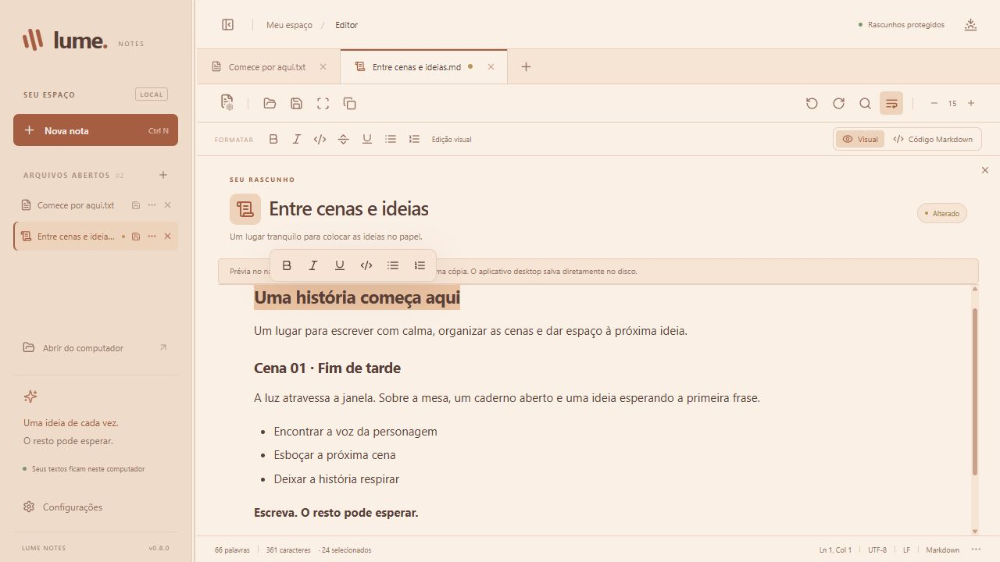

# Lume Notes

> **0.9.0: distribuição suspensa.** O Defender detectou `Trojan:Win32/Bearfoos.A!ml` no executável do instalador. Não instalar nem publicar esse pacote. Consulte a [auditoria](docs/auditoria-seguranca-0.9.0.md) e o [diagnóstico em ambiente limpo](docs/diagnostico-windows.md).

Versão **0.10.0 em desenvolvimento** — um editor local de texto e Markdown, com grupos de abas e um espaço tranquilo para escrever. A versão publicada é a [0.9.1](https://github.com/educastro100/lume-notes-releases/releases/latest), com instalação e atualização pelo aplicativo já validadas.

Editor de texto desktop em **Tauri 2 + Rust + React + TypeScript + Tiptap + CodeMirror 6**, criado para Windows x64. A interface usa fontes locais, sem depender de serviços externos.

## Organização do projeto

O código-fonte fica na raiz. Repositório no GitHub: [educastro100/lume-notes](https://github.com/educastro100/lume-notes). O pacote local 0.9.0 está bloqueado para investigação. O canal público de instaladores é [Lume Releases](https://github.com/educastro100/lume-notes-releases/releases/latest). `releases/` é ignorada pelo Git; o canal público contém somente instaladores, assinaturas e metadados de atualização.

A distribuição e o processo de atualização estão documentados em [docs/distribuicao.md](docs/distribuicao.md). A validação anterior está em [docs/validacao-0.8.0.md](docs/validacao-0.8.0.md).

A próxima versão usa o fluxo [Preparar release Windows](docs/release-actions.md): compilação e varredura pelo Actions, seguida de assinatura local com a chave existente. O workflow não publica automaticamente.



## Usar o aplicativo

Baixe o arquivo que termina em `-setup.exe` nos Assets da [release publicada](https://github.com/educastro100/lume-notes-releases/releases/latest). O instalador usa instalação por usuário, atalhos e Microsoft Edge WebView2 Runtime. O pacote antigo 0.9.0 continua bloqueado; as amostras de diagnóstico não são distribuídas como versão final.

Esta versão é local e não exige conta. Não há sincronização ou recursos de IA. A verificação de atualizações consulta apenas o canal público do GitHub; notas e nomes de arquivos não são enviados. O executável desta compilação não tem assinatura comercial.

A distribuição principal agora usa instalador NSIS. As versões portáteis anteriores continuam disponíveis localmente. O número completo da versão aparece no rodapé do painel e no título da janela. Feche versões anteriores antes de abrir a atualização, pois elas compartilham os dados locais.

## Recursos

- Abas, painel de arquivos abertos e histórico de desfazer/refazer por aba durante a sessão.
- Salvar e fechar diretamente pelo painel lateral, com proteção para alterações ainda não salvas.
- Grupos de abas com nome e cor: criar, renomear, recolher e desagrupar sem fechar os arquivos. Use o menu ⋯ de um arquivo para movê-lo ou arraste sua aba para um grupo. O + das abas cria uma nota sem grupo; Nova nota/Ctrl+N usa o grupo da nota ativa.
- Nomes, cores, associações e estado de recolhimento dos grupos ficam salvos na sessão. Rascunhos da versão 0.1 são migrados automaticamente.
- Edição visual de Markdown: negrito, itálico, sublinhado, código, divisórias, listas com marcadores e listas numeradas. Suporte a títulos, tabelas, tarefas e citações.
- Novas notas abrem em Markdown com edição visual. O modo Código Markdown oferece split opcional e mantém sua escolha por documento.
- Dezesseis ícones para identificar os assuntos dos documentos, incluindo Roteiro, Filme, Vídeo, Incidente, Requisição, Projeto, Reunião e Calendário. Clique no ícone ao lado do título ou use o menu ⋯ da nota; a escolha é lembrada pelo caminho do arquivo mesmo após fechar a aba, sem alterar seu texto.
- Arraste uma aba para a área sem grupo na faixa de abas ou no painel para retirá-la do grupo atual. O destino só fica destacado enquanto o arraste está sobre ele.
- Shift seleciona um intervalo de arquivos; Ctrl adiciona/remove um arquivo da seleção. Use o menu ⋯ de um dos selecionados para criar um grupo ou mover todos para um grupo existente. Grupos abrem e recolhem com transição suave.
- Abrir múltiplos arquivos, salvar e salvar como, com diálogos do Windows.
- Busca e substituição literal no texto visual; busca avançada com expressões regulares no modo de código.
- Temas **Manhã, Dia, Tarde, Noite e Madrugada**, com seleção de texto nas cores da paleta. Manhã usa tons claros e dourados; Tarde usa tons de pôr do sol.
- Fonte entre 11 e 28 px, ajustável pelos botões, atalhos ou scroll sobre o controle de tamanho.
- Quebra de linha opcional nos dois editores e na prévia; sem quebra, o texto pode ser percorrido horizontalmente.
- Painel lateral e split redimensionáveis por arraste, com limites adaptados à janela. Duplo clique na divisória restaura a medida padrão; as setas também ajustam a divisão.
- Fonte, quebra de linha, larguras e tema ficam salvos neste computador.
- Paleta de 12 cores para grupos, com realce suave da própria cor durante o arraste.
- Destaque para Markdown, JSON e JavaScript/TypeScript no modo de código.
- Contagem de palavras, caracteres, posição do cursor e seleção.
- Recuperação das abas e dos rascunhos após fechar o aplicativo; edições são guardadas após uma pausa de 500 ms e a sessão é gravada ao fechar normalmente.
- UTF-8, UTF-8 com BOM e UTF-16 LE/BE com BOM. O salvamento mantém a codificação e o padrão de quebra de linha detectado primeiro (LF, CRLF ou CR).
- Gravação em arquivo temporário na mesma pasta antes da substituição e verificação de alterações externas antes de salvar um arquivo já aberto.

## Atalhos

| Ação                     | Atalho                    |
| ------------------------ | ------------------------- |
| Novo arquivo             | Ctrl+N                    |
| Abrir                    | Ctrl+O                    |
| Salvar                   | Ctrl+S                    |
| Salvar como              | Ctrl+Shift+S              |
| Fechar aba               | Ctrl+W                    |
| Buscar e substituir      | Ctrl+F                    |
| Alternar abas            | Ctrl+Tab / Ctrl+Shift+Tab |
| Desfazer / refazer       | Ctrl+Z / Ctrl+Y           |
| Ajustar fonte            | Ctrl++ / Ctrl+- / Ctrl+0  |
| Negrito                  | Ctrl+B                    |
| Itálico                  | Ctrl+I                    |
| Sublinhado               | Ctrl+U                    |
| Código em linha ou bloco | Ctrl+Shift+C              |

## Formatação e grupos

Selecione um trecho e use a barra flutuante de formatação ou os botões fixos. No modo visual, os botões alteram diretamente a seleção; sem seleção, ativam o estilo para o que será digitado. Use Enter para continuar listas e Enter em um item vazio para encerrá-las. Desfazer e refazer ficam ao lado da lupa. Cada tecla e Enter têm uma etapa própria no histórico; colagens e formatações continuam sendo ações únicas. O histórico guarda até cerca de 2.000 etapas durante a sessão.

O modo **Código Markdown** exibe os marcadores; nele, **Split** liga/desliga a prévia ao lado. Os modos compartilham o conteúdo, que continua sendo salvo como Markdown: `**negrito**`, `*itálico*`, `<u>sublinhado</u>`, listas e divisórias. Apenas abrir uma nota ou trocar de modo não reescreve o texto. Após editar visualmente, o serializador pode normalizar marcadores e espaços. Documentos com imagens, HTML personalizado, frontmatter ou notas de rodapé permanecem no editor de código para preservar esses detalhes.

Novas notas recebem a extensão `.md`. Um `.txt` existente mantém seu caminho; use **Salvar como** para criar uma versão `.md`. O aplicativo não grava RTF ou DOCX. Tab e Shift+Tab recuam e desfazem recuos: em listas, alteram o nível; em código, usam tabulações; em parágrafos, usam espaços inseparáveis para manter o recuo no Markdown sem transformar o texto em bloco de código. O X à direita do cabeçalho fecha a nota atual e pede confirmação para documentos ainda não salvos que contenham texto e arquivos com alterações. Notas novas vazias fecham diretamente.

No painel, o botão **+** cria um grupo. Selecione vários arquivos com Shift ou Ctrl e use **⋯ → Criar grupo com N arquivos…** para reuni-los. O menu também move toda a seleção para um grupo existente ou para Sem grupo. O arraste transporta os arquivos selecionados. **Desagrupar arquivos** remove o grupo e mantém as notas abertas.

## Rascunhos

O aplicativo guarda a sessão em `session.json`, no diretório de dados do aplicativo identificado como `com.lume.notes` dentro de `%APPDATA%`. O tema, a fonte, a quebra de linha e as medidas do layout são persistidos no armazenamento local do WebView2. Os rascunhos são cópias locais em texto simples; salvar um rascunho não significa atualizar o arquivo original.

O limite é de 16 MiB por arquivo e 64 MiB para o JSON da sessão. Arquivos binários e codificações incompatíveis são recusados. Arquivos com finais de linha mistos são normalizados para o primeiro padrão encontrado. A recuperação guarda texto e abas, mas não o histórico de desfazer de sessões anteriores. Se a gravação da sessão falhar, o aplicativo avisa e pede confirmação antes de sair.

## Desenvolvimento

Instale Node.js/npm, Rust e os pré-requisitos do Tauri para seu sistema. Para o fluxo padrão no Windows, utilize Rust MSVC, Visual Studio C++ Build Tools e WebView2, conforme a documentação oficial: https://v2.tauri.app/start/prerequisites/.

```powershell
npm ci
npm run tauri -- dev
```

Compilar o executável:

```powershell
npm run tauri -- build --no-bundle
```

Prévia da interface no navegador:

```powershell
npm run dev
```

Na prévia, Abrir usa o seletor de arquivos do navegador e Salvar baixa uma cópia. O modo desktop grava diretamente no arquivo selecionado. As sessões do navegador e do aplicativo são independentes.

## Verificação

```powershell
npm test
npm run build
cargo test --manifest-path src-tauri/Cargo.toml --release
```

Os testes de texto cobrem acentos, emoji, as quatro codificações e os três padrões de quebra de linha, rejeição de texto inválido/binários e restauração de rascunhos. A migração e a persistência de grupos também são verificadas. Os testes de Markdown cobrem seleção, alternância de estilos, blocos de código, divisórias e renderização. Os testes Rust cobrem bytes preservados no disco, detecção de alterações externas e arquivos removidos antes do salvamento.

## Organização

- `src/App.tsx`: interface, comandos, abas e ciclo de vida.
- `src/documents.ts`: codificação e validação de sessões.
- `src/platform.ts`: adaptação entre navegador e desktop.
- `src/components/`: painel de arquivos, grupos, faixa de abas e prévia Markdown.
- `src/formatting.ts`: transformações de texto para os comandos Markdown.
- `src-tauri/src/main.rs`: leitura, gravação e persistência local.
- `src-tauri/capabilities/default.json`: permissões da janela.

Os arquivos `package-lock.json` e `src-tauri/Cargo.lock` fixam as dependências desta entrega. Os instaladores distribuídos são compilados no Actions com Windows/MSVC e NSIS oficiais. As ferramentas temporárias usadas nos testes locais não fazem parte do código-fonte distribuído.

## Design e tecnologias

A interface usa React e TypeScript. A edição visual usa Tiptap/ProseMirror, com conversão Markdown. O modo de código usa CodeMirror 6; a prévia usa react-markdown com remark-gfm e suporte limitado ao sublinhado. A integração desktop e a gravação em disco são implementadas em Rust com Tauri 2. O desenvolvimento e a compilação da interface usam Vite.

As cores, espaçamentos, temas e tipografia são definidos em CSS próprio em `src/styles.css`. Os temas compartilham variáveis de cor para manter a mesma identidade visual. Os ícones são Lucide; as fontes são Segoe UI e Cascadia Code/Consolas, locais do Windows.

O código-fonte inclui README, histórico de versões, guia de contribuição, regras de formatação e exclusões de arquivos locais. O repositório remoto do projeto é [educastro100/lume-notes](https://github.com/educastro100/lume-notes), na branch principal `main`.

## Novidades da versão 0.6

Configurações no rodapé esquerdo permitem escolher entre português, inglês, francês, alemão, grego e chinês simplificado. A preferência fica salva localmente e só altera a interface.

F8 alterna o modo foco; Esc ou o botão discreto no canto superior direito retorna ao editor completo. O tema Madrugada completa Dia, Tarde e Noite; cores e ícones mudam suavemente. O sistema com movimento reduzido desativa as transições.

Fechar todas as notas deixa o espaço vazio, inclusive ao reabrir. A pesquisa visual destaca todas as ocorrências enquanto você digita e mantém a marcação ao navegar entre resultados.

## Novidades da versão 0.7

O botão Foco fica à direita de Salvar. A entrada e a saída têm uma breve animação de desfoque. Configurações abre e fecha suavemente. As animações respeitam a opção de movimento reduzido do sistema.

Clique no título para editar e confirme com Enter ou o botão de check; Esc cancela. A extensão é preservada. Nas notas novas, o título fica salvo na sessão e é sugerido ao escolher onde salvar. Em arquivos existentes, a confirmação renomeia o arquivo na pasta atual, sem substituir outro arquivo. O texto não é regravado ao renomear: alterações ainda não salvas continuam pendentes. Arquivos alterados externamente precisam ser reabertos ou salvos em cópia antes da renomeação.

O botão Salvar de cada linha da lateral aparece apenas em notas sem arquivo ou com alterações pendentes. Abrir um alias de arquivo já aberto revela a aba original. Fechar com Salvar não descarta texto digitado durante o salvamento.

## Novidades da versão 0.8

Em Configurações, **Tema automático** acompanha o horário local: Dia das 6h às 16h, Tarde das 16h às 19h, Noite das 19h à meia-noite e Madrugada da meia-noite às 6h. Fica desligado inicialmente. Escolher uma paleta pelo menu de temas desativa o automático; a escolha fica salva. A barra da janela também segue a paleta.

Ao selecionar texto, uma barra próxima ao trecho oferece formatação e listas nos dois editores. Esc a fecha. O botão **Copiar todo o conteúdo**, ao lado de Foco, copia o texto completo, incluindo os marcadores Markdown. Foco expande suavemente o painel de escrita com um breve desfoque.

Para usar o **Abrir com Lume**, mantenha o portátil em uma pasta definitiva e clique em **Configurações → Adicionar ao Abrir com**. O registro é por usuário, para .txt, .md, .json, .log e .csv, e não substitui seu aplicativo padrão. A mesma seção permite removê-lo. Ao mover/atualizar o executável, adicione novamente pela versão no novo caminho. A associação aponta para essa pasta, portanto mantenha o executável e a DLL juntos. O Lume abre os arquivos enviados pelo sistema na instância já em uso; as versões antigas devem ser fechadas antes da atualização.

Os ícones Roteiro, Filme e Vídeo se somam aos oito existentes. A memória de ícones usa o caminho do arquivo no armazenamento local; renomeações feitas no Lume atualizam o caminho, enquanto movimentos feitos fora dele passam a ser um novo arquivo para essa memória. Rascunhos mantêm o ícone na sessão.

## Novidades da versão 0.9

Instalador Windows por usuário com menu Iniciar, atalho e desinstalador. O identificador `com.lume.notes` e o armazenamento local são preservados para recuperar a sessão das versões portáteis anteriores.

O instalador registra o Lume no **Abrir com** e em **Aplicativos padrão** para .txt, .md, .json, .log e .csv. Não escreve o aplicativo padrão dessas extensões nem a chave UserChoice. Em Configurações, **Escolher padrões do Windows** abre a página onde o usuário escolhe as associações; **Reparar integração** restaura o registro do Lume instalado.

**Verificar atualizações** consulta o canal público de pacotes. A verificação automática pode ser desativada e ocorre após abrir o app, no máximo uma vez a cada 24 horas após uma consulta bem-sucedida. O download só começa após **Atualizar e reiniciar**. O pacote é validado com assinatura criptográfica vinculada à versão; então o editor é bloqueado, a sessão atual é gravada e o instalador é iniciado. Falhas de download, assinatura ou gravação não fecham o editor para instalar. A versão portátil não tenta se atualizar como uma instalação.

Código-fonte e ferramentas de publicação permanecem no repositório privado. O canal [lume-notes-releases](https://github.com/educastro100/lume-notes-releases) recebe somente os pacotes distribuíveis.

## Novidades da versão 0.10

A formatação visual combina negrito, itálico e sublinhado com código em linha, preservando os estilos e os caracteres literais ao reabrir o Markdown. Listas com marcadores, números e tarefas têm margens uniformes, inclusive ao continuar com Enter ou aninhar itens.

**Configurações → Ajuda e atalhos** reúne os atalhos mais comuns e botões para abrir a apresentação do projeto e as issues públicas no navegador padrão. O seletor de idiomas usa bandeiras locais em SVG e pode ser operado pelo teclado. Esc fecha primeiro a lista de idiomas e depois as configurações.

O tema Manhã completa o ciclo. Os períodos automáticos têm quatro ou cinco horas: Madrugada 0h–5h, Manhã 5h–10h, Dia 10h–15h, Tarde 15h–19h e Noite 19h–0h, no horário local. As preferências anteriores continuam válidas.

O botão **Abrir do computador** fica ao lado de **Nova nota** no topo esquerdo. Incidente, Requisição, Projeto, Reunião e Calendário completam a grade de ícones. A ativação de Markdown pela formatação de um texto mostra um aviso para salvar; o caminho original é mantido, e **Salvar como** permite criar uma cópia `.md`.
