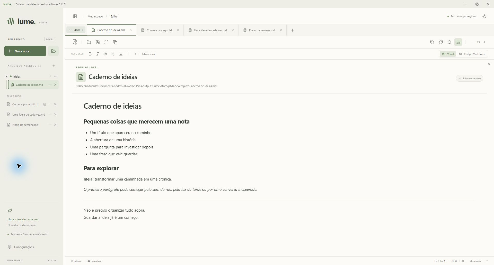
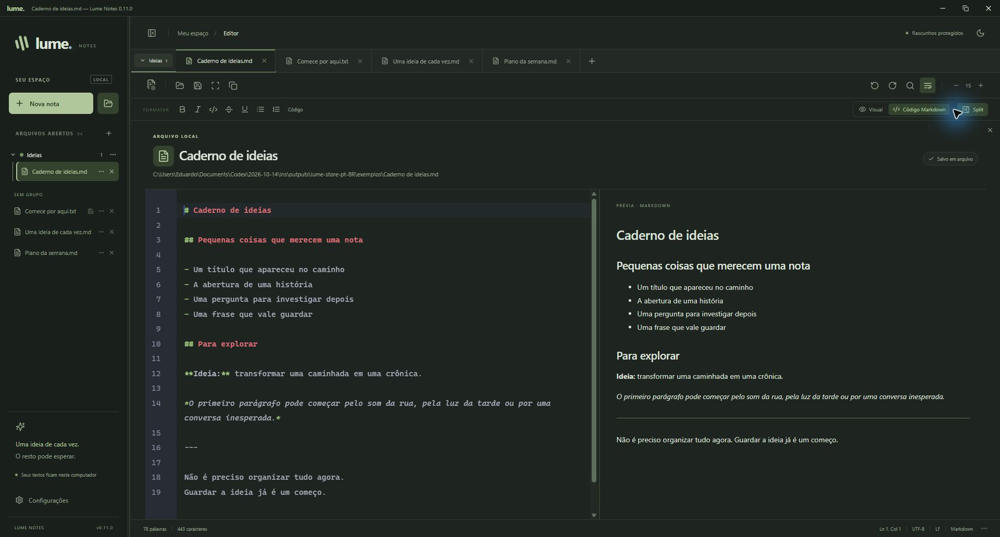

# Lume Notes

**Um espaço tranquilo para escrever. Uma ideia de cada vez. O resto pode esperar.**

O Lume é um editor gratuito de texto e Markdown para Windows, com edição visual, grupos de abas, rascunhos locais e temas que acompanham o dia. Escreva e organize seus documentos sem precisar de uma conta no aplicativo.

**[Baixar na Microsoft Store](https://apps.microsoft.com/detail/9N09X4KQ1D3V)** · [Ajuda e sugestões](https://github.com/educastro100/lume-notes-releases/issues) · [Licença MIT](LICENSE)



## Baixar e instalar

1. Abra a [página do Lume Notes na Microsoft Store](https://apps.microsoft.com/detail/9N09X4KQ1D3V).
2. Clique em **Obter** ou **Instalar** e siga as instruções da Store.
3. Abra o **Lume Notes** pelo menu Iniciar ou pela própria Store.

Disponível para **Windows 10, versão 2004/build 19041 ou posterior, e Windows 11, em computadores x64**. O aplicativo utiliza o Microsoft Edge WebView2 Runtime. Se ele não estiver disponível, o Lume oferece abrir a página oficial da Microsoft para obtê-lo.

A Microsoft Store é o canal principal de instalação e atualização. Os arquivos de código-fonte e os artefatos de compilação do GitHub são destinados ao desenvolvimento.

### Já usava a instalação do GitHub?

Salve os documentos importantes em arquivos antes de instalar a edição da Store. Depois, confira suas notas, grupos e preferências nela antes de remover a instalação antiga. As edições podem coexistir; a migração automática dos rascunhos e das configurações entre elas ainda não foi validada.

### Como atualizar

As atualizações desta edição são distribuídas pela **Microsoft Store**. Ative as atualizações automáticas na Store ou procure novas versões na área **Biblioteca/Downloads**.

Em **Configurações → Atualizações**, o Lume mostra a versão instalada e o botão **Abrir Microsoft Store**, que direciona para a área de atualizações da loja. A edição da Store não consulta o atualizador do GitHub.

## Primeiros passos

1. Clique em **Nova nota** ou pressione **Ctrl + N**. Notas novas começam em Markdown, com edição visual.
2. Escreva e selecione um trecho para usar a barra de formatação: negrito, itálico, sublinhado, código e listas.
3. Use **Ctrl + S** para escolher onde salvar. Para abrir documentos existentes, use **Abrir do computador**, ao lado de Nova nota, ou **Ctrl + O**.
4. Organize seus documentos em grupos com nomes e cores. Use o menu **⋯** de uma nota para movê-la; selecione várias com **Ctrl** ou **Shift** para agrupá-las de uma vez.
5. Escolha um tema ou ative **Tema automático** nas configurações. Pressione **F8** para entrar no modo foco.

O aplicativo recupera abas e rascunhos ao reabrir. Essa recuperação **não substitui salvar o arquivo**: use Salvar ou Salvar como para gravar suas alterações no documento original ou em uma cópia.

## Recursos

- **Texto e Markdown:** edição visual com Tiptap e modo de código com prévia lado a lado opcional.
- **Formatação:** negrito, itálico, sublinhado, código em linha ou bloco, títulos, divisórias, listas, citações, tabelas e tarefas.
- **Abas e grupos:** nomes e cores, seleção de vários arquivos, arraste entre grupos e reordenação dos grupos na lateral ou na faixa de abas.
- **Identidade por documento:** dezoito ícones, incluindo Roteiro, Filme, Vídeo, Incidente, Requisição, Projeto, Reunião, Calendário, Compras e Processo.
- **Retomar a escrita:** recuperação local de abas, rascunhos, grupos e preferências.
- **Cinco temas:** Manhã, Dia, Tarde, Noite e Madrugada, com opção de acompanhar o horário local e transições suaves.
- **Modo foco:** expande a área de escrita; F8 alterna o modo e Esc retorna ao editor completo.
- **Espaço ajustável:** fonte de 11 a 28 px, quebra de linha opcional e divisórias redimensionáveis para a lateral e a prévia.
- **Busca e revisão:** pesquisa com destaque, substituição, expressões regulares no modo de código, contadores e desfazer/refazer durante a sessão.
- **Arquivos locais:** abertura de múltiplos documentos e destaque de sintaxe para Markdown, JSON e JavaScript/TypeScript no modo de código.
- **Integração com Windows:** Abrir com Lume para `.txt`, `.md`, `.json`, `.log` e `.csv`. Você escolhe os aplicativos padrão nas configurações do Windows.
- **Sete idiomas:** português do Brasil, inglês, espanhol, francês, alemão, grego e chinês simplificado.
- **Ajuda no aplicativo:** configurações, ajuda e atalhos reunidos em abas no mesmo painel.

## Markdown e organização

No modo visual, a formatação aparece enquanto você escreve. O modo **Código Markdown** exibe os marcadores; nele, **Split** liga ou desliga a prévia ao lado. Os modos compartilham o mesmo conteúdo.



Ao aplicar formatação a um texto simples, o Lume avisa sobre a mudança para Markdown e a necessidade de salvar. Um arquivo `.txt` existente mantém seu caminho: use **Salvar como** para criar uma cópia `.md`. O aplicativo não grava arquivos RTF ou DOCX.

Documentos com imagens, HTML personalizado, frontmatter ou notas de rodapé permanecem no editor de código para preservar esses detalhes. Após uma edição visual, a conversão para Markdown pode normalizar marcadores e espaços.

Para organizar as abas:

- Use o menu **⋯** de uma nota para criar ou escolher um grupo.
- Arraste uma nota para um grupo ou para a área **Sem grupo**.
- Arraste o nome de um grupo para mudar sua posição; **Alt + setas** também permite reordená-lo.
- Clique no título do documento para renomeá-lo e no ícone ao lado para escolher outro símbolo.
- Use **Desagrupar arquivos** para remover um grupo mantendo as notas abertas.

## Atalhos

| Ação                                  | Atalho                          |
| ------------------------------------- | ------------------------------- |
| Nova nota                             | Ctrl + N                        |
| Abrir arquivos                        | Ctrl + O                        |
| Salvar                                | Ctrl + S                        |
| Salvar como                           | Ctrl + Shift + S                |
| Fechar a aba atual                    | Ctrl + W                        |
| Buscar e substituir                   | Ctrl + F                        |
| Alternar abas                         | Ctrl + Tab / Ctrl + Shift + Tab |
| Negrito / itálico / sublinhado        | Ctrl + B / Ctrl + I / Ctrl + U  |
| Código em linha ou bloco              | Ctrl + Shift + C                |
| Desfazer / refazer                    | Ctrl + Z / Ctrl + Y             |
| Recuar / remover recuo                | Tab / Shift + Tab               |
| Aumentar / diminuir / restaurar fonte | Ctrl + + / Ctrl + - / Ctrl + 0  |
| Alternar modo foco                    | F8                              |

## Seus textos ficam neste computador

O Lume não exige cadastro, não inclui anúncios e não oferece sincronização na nuvem nem recursos de IA. Notas e nomes de arquivos não são enviados pelo aplicativo ao desenvolvedor. A Store gerencia o download e as atualizações da edição distribuída por ela.

Os rascunhos são cópias locais em texto simples. O Lume recupera o conteúdo e as abas, mas não o histórico de desfazer de sessões anteriores. O armazenamento usa o identificador `com.lume.notes`; a localização efetiva dos dados pode variar entre as instalações tradicionais e a edição MSIX.

O editor aceita UTF-8, UTF-8 com BOM e UTF-16 LE/BE com BOM, preservando a codificação e o primeiro padrão de quebra de linha encontrado. O limite é de **16 MiB por arquivo** e **64 MiB para a sessão**. Antes de substituir um arquivo, o aplicativo grava uma cópia temporária na mesma pasta e verifica alterações externas.

## Ajuda e sugestões

Encontrou um problema ou tem uma ideia? Abra uma [issue no canal de suporte](https://github.com/educastro100/lume-notes-releases/issues), informando a versão do Lume, o que aconteceu e como reproduzir. Evite incluir documentos pessoais ou informações confidenciais em solicitações públicas.

Os mesmos links e a referência de atalhos estão disponíveis no painel de configurações do aplicativo.

## Desenvolvimento

O projeto usa **Tauri 2 e Rust** na integração com o Windows, **React e TypeScript** na interface, **Tiptap/ProseMirror** na edição visual e **CodeMirror 6** no modo de código. A prévia usa react-markdown/remark-gfm; a interface é compilada com Vite. Cores, temas e animações usam CSS próprio, com ícones Lucide e fontes locais do Windows.

Instale Node.js/npm, Rust MSVC, Visual Studio C++ Build Tools e WebView2, conforme os [pré-requisitos oficiais do Tauri](https://v2.tauri.app/start/prerequisites/).

```powershell
npm ci
npm run tauri -- dev
```

Para uma prévia da interface no navegador:

```powershell
npm run dev
```

Na prévia, Abrir usa o seletor do navegador e Salvar baixa uma cópia. No aplicativo desktop, o salvamento grava no arquivo selecionado. As sessões do navegador e do aplicativo são independentes.

### Verificação

```powershell
npm test
npm run build
cargo test --manifest-path src-tauri/Cargo.toml --release
```

Os arquivos `package-lock.json` e `src-tauri/Cargo.lock` fixam as dependências. A edição da Store é compilada com Windows/MSVC no GitHub Actions e empacotada como MSIX para submissão no Partner Center.

## Código, documentação e distribuição

| Local                                                                      | Finalidade                                                                                     |
| -------------------------------------------------------------------------- | ---------------------------------------------------------------------------------------------- |
| [lume-notes](https://github.com/educastro100/lume-notes)                   | Código-fonte público, testes e workflows de compilação.                                        |
| [Microsoft Store](https://apps.microsoft.com/detail/9N09X4KQ1D3V)          | Instalação e atualizações da edição atual para Windows.                                        |
| [lume-notes-releases](https://github.com/educastro100/lume-notes-releases) | Canal legado de instaladores e metadados do atualizador do GitHub, além das issues de suporte. |

- [Como contribuir](CONTRIBUTING.md)
- [Histórico de versões](CHANGELOG.md)
- [Compilação e publicação na Microsoft Store](docs/microsoft-store.md)
- [Documentação do canal legado](docs/distribuicao.md)
- [Política de segurança](SECURITY.md)
- [Assinatura de código](docs/code-signing.md)

## Licença

O código próprio do Lume é distribuído sob a [licença MIT](LICENSE). As dependências mantêm suas próprias licenças e avisos.

Desenvolvido por **Eduardo Castro Junqueira**.
